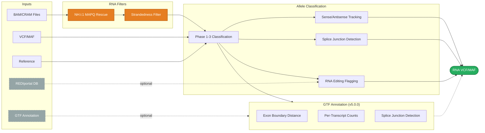
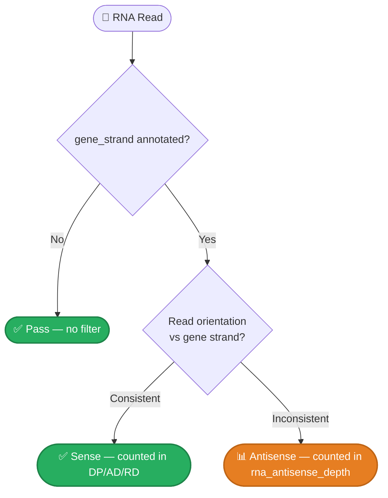

# gbcms rna

Count alleles in RNA-seq BAM/CRAM files with transcriptome-aware filtering.

RNA mode extends the core DNA counting engine with filters and metrics specific to RNA-seq data: STAR-aware MAPQ rescue, dUTP strandedness filtering, splice junction tracking, A-to-I RNA editing site flagging, GTF-based transcript annotation, and amplicon library support.

## When to Use


| Scenario | Command |
|:---------|:--------|
| cfDNA (ACCESS, IMPACT) | `gbcms dna` |
| WGS / WES / Panel | `gbcms dna` |
| STAR + dUTP (reverse) RNA-seq | `gbcms rna` |
| STAR + dUTP + GTF annotation | `gbcms rna --gtf genes.gtf` |
| Forward-stranded (fr-secondstrand) RNA-seq | `gbcms rna --strandedness forward` |
| Unstranded RNA-seq | `gbcms rna --strandedness unstranded` |
| Amplicon RNA libraries | `gbcms rna --library-type amplicon` |

## Synopsis

```bash
gbcms rna [OPTIONS] --variants <FILE> --bam <NAME:PATH>... --fasta <FILE> --output-dir <DIR>
```

`--variants`, `--fasta` and `--output-dir` are required, and so is one of `--bam` or
`--bam-list`, as in `gbcms dna`.

## RNA Pipeline Overview



---

## Required Arguments

!!! info "Shared Arguments"
    RNA mode shares all [required arguments](dna.md#required-arguments), [output options](dna.md#output-options), [filtering options](dna.md#filtering-options), [BAQ options](dna.md#baq-options), [UMI options](dna.md#umi-options), [MNP rescue options](dna.md#mnp-rescue-options), the [homopolymer twin option](dna.md#homopolymer-twin-option), and [debugging options](dna.md#debugging-options) with DNA mode. See the [`gbcms dna` reference](dna.md) for full descriptions.

!!! tip "Provenance & CRAM Support (v5.3.0+)"
    RNA output includes the same provenance metadata as DNA mode — `##gbcms_command`,
    `##reference`, `##contig`, and `##FILTER` in VCF headers; `#gbcms` and `#command`
    comment lines in MAF output.  `--bam` accepts both BAM and CRAM files
    transparently.  See [CRAM Support](dna.md#required-arguments) for details.

!!! tip "BAQ is On by Default in RNA Mode"
    Unlike DNA mode, `--apply-baq` defaults to **on** for RNA. BAQ penalizes bases within 5 bp of both indels and splice junctions (CIGAR `N`), serving as a lightweight alternative to GATK SplitNCigarReads. Disable with `--no-baq` if your upstream workflow already runs SplitNCigarReads or BQSR. See [RNA Splice-Junction Handling](../reference/rna-splice-handling.md).

| Option | Description |
|:-------|:------------|
| `--variants`, `-v` | VCF or MAF file |
| `--bam`, `-b` | BAM or CRAM file(s) |
| `--fasta`, `-f` | Reference FASTA (with .fai index). Also used for CRAM decoding. |
| `--output-dir`, `-o` | Output directory |

---

## RNA-Specific Options

These options are **only available** on `gbcms rna`, not on `gbcms dna`.

### GTF Annotation (v5.0.0)

| Option | Default | Description |
|:-------|:--------|:------------|
| `--gtf` | _(none)_ | Path to Ensembl/GENCODE GTF annotation file, plain or gzip/BGZF (`.gtf` or `.gtf.gz`). Enables exon boundary distance, per-transcript counting, and aberrant splice junction detection. Also resolves each variant's gene strand from the annotation (a `gene_strand` column in the input MAF is not read) — required for `--enforce-strandedness` and ASJD strand-discordance to do anything. |

!!! info "What `--gtf` Enables"
    When a GTF file is provided, gbcms builds a `COITree`-based annotation index and adds:

    - **`exon_boundary_dist`** — Distance (bp, unsigned) from the variant's REF span to the nearest annotated exon boundary, `0` when a boundary lies inside it; empty when the variant's contig has no annotation in the GTF
    - **Per-transcript read/fragment counts** — `|`-separated `GENE:TX:READ_COUNT` and `GENE:TX:FRAG_COUNT` strings
    - **ASJD detection** — 14 columns for Aberrant Splice Junction Detection, comparing read splice junctions against annotated transcript splice sites

    See [RNA Annotation](../reference/rna-annotation.md) for full details.

!!! tip "GTF Format Requirements"
    gbcms supports both Ensembl (`.gtf`) and GENCODE (`.gtf.gz`) GTF files. The parser reads `exon` feature rows and uses `gene_name` and `transcript_id` attributes.

    ```bash
    # Ensembl
    wget https://ftp.ensembl.org/pub/release-112/gtf/homo_sapiens/Homo_sapiens.GRCh38.112.gtf.gz
    # GENCODE
    wget https://ftp.ebi.ac.uk/pub/databases/gencode/Gencode_human/release_46/gencode.v46.annotation.gtf.gz
    ```

### Strandedness Protocol

| Option | Default | Description |
|:-------|:--------|:------------|
| `--strandedness` | `reverse` | RNA library strand protocol: `reverse`, `forward`, or `unstranded` |

Controls how a read's genomic orientation folds to the **transcript strand** it
originated from. This fold drives both `--enforce-strandedness` filtering and ASJD
strand-discordance detection. For an unstranded library use `--strandedness
unstranded` (see [Strandedness Filtering](#strandedness-filtering)).

| Value | featureCounts | Convention | Sense mate |
|:------|:--------------|:-----------|:-----------|
| `reverse` (default) | `-s 2` | dUTP / fr-firststrand | R2 |
| `forward` | `-s 1` | fr-secondstrand | R1 |
| `unstranded` | `-s 0` | none | — |

!!! info "Picking the right value"
    `reverse` is the default — it matches the **FORTE** pipeline default and dUTP
    library preps. If unsure, run RSeQC `infer_experiment.py` (a ~90%+ majority for
    `1+-,1-+,2++,2--` means `reverse`; `1++,1--,2+-,2-+` means `forward`) or check the
    `featureCounts -s` flag your upstream pipeline used. `unstranded` disables strand
    filtering and strand-discordance entirely (and is implied by `--library-type
    amplicon`). An unknown value is rejected with an error rather than silently
    defaulting.

### Library Type (v5.0.0)

| Option | Default | Description |
|:-------|:--------|:------------|
| `--library-type` | `capture` | RNA library preparation method: `capture` (IDT xGen-style, default) or `amplicon` |

!!! info "Amplicon Mode Behavior"
    In **amplicon** libraries, R1 and R2 reads are PCR duplicates of the same template molecule — they are **not** independent fragment ends like in capture libraries. When `--library-type amplicon` is set:

    1. **Fragment consensus bypass**: R1 and R2 are treated as independent observations (XOR trick on `mol_hash`), preventing incorrect merging.
    2. **Strandedness forced to `unstranded`**: Amplicon libraries are not strand-specific, so the CLI sets `--strandedness unstranded` (logged), which turns off `--enforce-strandedness` and ASJD's strand-discordance check together.
    3. **Effect on counts**: `dpf ≈ dp` (fragment counts approach read counts) because no R1/R2 merging occurs.

### Strandedness Filtering

| Option | Default | Description |
|:-------|:--------|:------------|
| `--enforce-strandedness/--no-strandedness` | `true` | Filter reads by their orientation relative to the gene strand, folded under the `--strandedness` protocol |

!!! info "Biological Context: dUTP Stranded Libraries"
    In dUTP-stranded RNA-seq, the second strand (synthesized with dUTP) is degraded, so sequenced reads reflect the **antisense** strand of the original mRNA. The strandedness filter uses the variant's gene strand, resolved from the `--gtf` exons at its position, to determine whether each read's orientation is consistent with the expected transcript direction.

    **For an unstranded library, pass `--strandedness unstranded`.** It turns off the
    filter and ASJD's strand-discordance check together, and every read counts as sense
    (`rna_antisense_depth` is 0). `--no-strandedness` alone only stops the filtering: reads
    are still folded to a transcript strand under the default `reverse` protocol, so an
    unstranded library's reads are split into `rna_sense_depth` and `rna_antisense_depth`
    by a strand that does not exist, and ASJD's `STRAND_DISCORDANT` check runs on that
    fold. Use `--no-strandedness` to keep a stranded library's antisense reads in the
    counts while still tallying them in `rna_antisense_depth`.

!!! warning "Amplicon Override"
    When `--library-type amplicon` is used, the CLI sets `--strandedness unstranded`, and
    `--enforce-strandedness` is **automatically disabled** regardless of the flag value.
    Amplicon libraries are not strand-specific by design.



### RNA Editing Database

| Option | Default | Description |
|:-------|:--------|:------------|
| `--rna-editing-db` | _(none)_ | Path to REDIportal TABLE1 file of known A-to-I RNA editing sites (`.gz` supported) |

!!! info "Biological Context: A-to-I RNA Editing"
    ADAR (Adenosine Deaminase Acting on RNA) enzymes convert adenosine to inosine in double-stranded RNA regions. Inosine is read as guanosine by the sequencing machinery, creating apparent **A→G variants** that are biological RNA modifications — not somatic mutations. Flagging these sites prevents false-positive variant calls.

    The REDIportal database catalogs >16 million known human A-to-I editing sites from multiple tissues and conditions.

!!! tip "Obtaining REDIportal"
    Download from [REDIportal](http://srv00.recas.ba.infn.it/atlas/):
    ```bash
    # Download TABLE1 format (tab-separated, 1-based coordinates)
    wget http://srv00.recas.ba.infn.it/atlas/download/TABLE1_hg38.txt.gz
    ```
    The file is loaded once at startup and stored as a hash set for O(1) lookup per variant.

---

## Observation Options

| Flag | Default | Description |
|:-----|:--------|:------------|
| `--observations-parquet` | `false` | Write a companion `<sample>.observations.parquet` with the per-molecule allele call at each variant. Works on spliced (N-CIGAR) alignments; the rows are molecule-level, not isoform-level. See [Per-Molecule Observations](../reference/molecule-observations.md). |

## Quality Thresholds

| Option | DNA Default | RNA Default |
|:-------|:------------|:------------|
| `--min-mapq` | 20 | **1** |
| `--min-baseq` | 20 | 20 |
| `--fragment-qual-threshold` | 10 | 10 |

`--min-baseq` masks bases, never reads: a base below it is read as unknown, like `N`, and
the read still counts toward depth, judged on its other bases (see [Read Filters → Quality
Thresholds](../reference/read-filters.md#quality-thresholds)). BAQ, on by default in RNA
mode, lowers qualities near splice junctions and indels before this threshold applies.

The RNA `--min-mapq 1` default keeps the primary alignments of reads STAR placed at two
to four loci (MAPQ 3 or 1); the measurement behind it and the cost of unique-only
counting are in [Read Filters → Why the RNA default is
`--min-mapq 1`](../reference/read-filters.md#why-the-rna-default-is-min-mapq-1).

---

## RNA Read Filters

RNA mode extends the standard [read filter cascade](../reference/read-filters.md) with
an `NH:i:1` rescue of reads that fail the MAPQ threshold, described in
[Read Filters → NH:i:1 MAPQ Rescue](../reference/read-filters.md#nhi1-mapq-rescue), and
the [strandedness filter](#strandedness-filtering) above.

### Filter Defaults

RNA mode uses the **same filter defaults** as DNA mode — duplicates, secondary, supplementary, and QC-failed reads are all filtered by default in both modes:

| Filter | DNA Default | RNA Default |
|:-------|:------------|:------------|
| `--filter-secondary` | on | on (same) |
| `--filter-supplementary` | on | on (same) |
| `--filter-qc-failed` | on | on (same) |

!!! caution "Known Limitation: Variants at Exon-Intron Boundaries"
    Junction-spanning reads are handled by the [splice-aware evidence
    rule](../reference/rna-splice-handling.md#the-evidence-rule-what-a-refskip-means):
    an indel op directly after the splice `N` is examined structurally, but a
    junction read that would need **alignment-based** (Phase 3) scoring — e.g.
    a delins carrier whose ops sit across the junction — classifies `neither`
    rather than being scored against a stitched sequence. (An earlier
    consensus intron-snipping step that spliced `ref_context` for Phase 3 was
    removed: it had no coordinate map, so it corrupted sequence verification
    near junctions and mis-scored exon-contained reads.) This is conservative:
    such reads count `dp` but neither allele. Deletion loci where reads
    asserting splicing over the span outnumber confirmed ALT are flagged
    `SPLICE_SKIP_DOMINANT(n)` in `gbcms_diagnostic`.

    **Inspection:** `--trace` logs every per-read decision; the debug-level
    `Phase stats` line reports `splice_skip_excluded=` per variant:
    ```bash
    gbcms rna --trace ... 2>&1 | grep "splice\|<chrom>:<pos>"
    ```

---

## Alignment Backend

RNA mode uses the same **two-stage Phase 3 pipeline** as DNA:

1. **WFA fast-path** (`wfa2lib-rs`) — edit-distance triage; resolves ~70-80% of reads instantly.
2. **Marginalized PairHMM** (escalated when WFA is ambiguous) — uses per-base quality probabilities for confident LLR scoring.

RNA uses **relaxed gap penalties** to tolerate reverse transcriptase (RT) stutter artifacts:

| Option | DNA Default | RNA Default | Rationale |
|:-------|:------------|:------------|:----------|
| `--alignment-backend` | `pairhmm` | `pairhmm` | Same (WFA + PairHMM) |
| `--gap-open-prob` | `1e-4` | **`5e-3`** | RT introduces more gap artifacts than DNA polymerase |
| `--gap-extend-prob` | `0.1` | **`0.25`** | RT stutter extends gaps more frequently |

!!! info "Biological Context: RT Stutter"
    Reverse transcriptase (used in cDNA synthesis) has lower fidelity than DNA polymerases and frequently introduces insertions/deletions at homopolymer runs and microsatellite regions. The relaxed gap penalties prevent these artifacts from being classified as ALT-supporting reads.

!!! info "Complex Indel Support in RNA Mode"
    All complex indel classification improvements — Del+SNV routing (`GC→T` pattern), large deletion REF visibility, and left-alignment shifted deletion rescue — apply identically to RNA mode. The allele classification engine (`variant_checks.rs`) has no mode branches; RNA reads go through the same Phase 1/2/3 pipeline as DNA reads.

    See [Complex Indels](../reference/complex-indels.md) for case studies and read-level examples.

    **Note on left-alignment shift (Fix 4):** This fix was motivated by BWA's indel left-alignment behaviour, where the variant anchor can sit several bases left of where the CIGAR `D` op appears in reads. STAR does not left-align indels in the same way, so this scenario is less common in RNA BAMs — but it still applies when STAR places a CIGAR `D` slightly offset from the annotated position, or when the input MAF was derived from a BWA-aligned DNA call set being counted against an RNA BAM.

### Read judgment

| Option | Default | Description |
|:-------|:--------|:------------|
| `--read-judge` | `rules` | Only `rules`, the size-specific read rules, in RNA mode. The sequence judge (`sequence`, opt-in for DNA, see [the DNA command](dna.md#read-judgment)) does not judge spliced reads yet, so `gbcms rna --read-judge sequence` exits with an error; RNA under the judge is [#333](https://github.com/msk-access/gbcms/issues/333). |

---

## QC Summary in the Run Log

The run log ends with a **QC summary**: which QC flags fired, on how many rows, which
rows need a look and what to do about each, then a `WARNING` when any row needs a look or an
`INFO` line when none does. It reads the output after writing it and changes nothing. See
[QC Flags → End-of-run summary](../reference/qc-flags.md#end-of-run-summary).

---

## RNA-Specific Output Columns

??? info "RNA-Specific Output Columns (click to expand)"

    When running in RNA mode, additional columns capture transcriptome-specific metrics. These columns are **absent** from DNA mode output.

    ### MAF Columns (5 additional)

    | Column | Type | Description |
    |:-------|:-----|:------------|
    | `rna_sense_depth` | u32 | REF and ALT reads on the gene **sense** strand |
    | `rna_antisense_depth` | u32 | REF and ALT reads on the gene **antisense** strand, tallied even when `--enforce-strandedness` keeps them out of every count |
    | `rna_alt_sense_count` | u32 | ALT-classified reads on the sense strand |
    | `rna_editing_site` | bool | QC flag (`--rna-editing-db`): [definition](../reference/qc-flags.md#qc-columns) |
    | `rna_splice_spanning` | u32 | ALT-classified reads containing splice junctions (CIGAR `N` operations) spanning the variant |

    ### VCF INFO Fields (5 additional)

    | Field | Type | Description |
    |:------|:-----|:------------|
    | `SEN` | Integer | Sense strand depth |
    | `ANT` | Integer | REF and ALT reads on the antisense strand (tallied under enforcement too) |
    | `ASEN` | Integer | ALT sense strand count |
    | `RED` | Flag | Known A→I RNA editing site overlap (flag; present if true) |
    | `SPL` | Integer | Splice-spanning ALT read count |

    ### VCF FORMAT Fields (4 additional)

    Per-sample fields added to the FORMAT column:

    | Field | Type | Description |
    |:------|:-----|:------------|
    | `SEN` | Integer | Per-sample sense depth |
    | `ANT` | Integer | Per-sample REF and ALT reads on the antisense strand |
    | `ASEN` | Integer | Per-sample ALT sense count |
    | `SPL` | Integer | Per-sample splice-spanning count |

    !!! note "RED is INFO-only"
        The `RED` editing-site flag appears only in the VCF INFO column (as a flag field), not in the per-sample FORMAT column.

---

## Examples

=== "Basic RNA"

    ```bash
    gbcms rna \
        --variants mutations.vcf \
        --bam rna_sample:star_aligned.bam \ # (1)!
        --fasta reference.fa \
        --output-dir results/
    ```

    1. STAR-aligned BAMs should have the `NH` tag for multi-mapping rescue.

=== "With GTF Annotation"

    ```bash
    gbcms rna \
        --variants mutations.maf \
        --bam tumor_rna:aligned.bam \
        --fasta hg38.fa \
        --gtf Homo_sapiens.GRCh38.112.gtf.gz \ # (1)!
        --format maf \
        --output-dir results/
    ```

    1.  Enables exon boundary distance, per-transcript counting, and ASJD detection. See [RNA Annotation](../reference/rna-annotation.md).

=== "With Editing DB"

    ```bash
    gbcms rna \
        --variants mutations.maf \
        --bam tumor_rna:aligned.bam \
        --fasta hg38.fa \
        --rna-editing-db TABLE1_hg38.txt.gz \ # (1)!
        --format maf \
        --output-dir results/
    ```

    1.  REDIportal TABLE1 format. Download from [REDIportal](http://srv00.recas.ba.infn.it/atlas/).

=== "Amplicon Library"

    ```bash
    gbcms rna \
        --variants mutations.vcf \
        --bam amplicon_sample:amplicon.bam \
        --fasta reference.fa \
        --library-type amplicon \ # (1)!
        --output-dir results/
    ```

    1.  Bypasses fragment consensus (R1/R2 treated as independent). Auto-disables `--enforce-strandedness`.

=== "Unstranded Library"

    ```bash
    gbcms rna \
        --variants mutations.vcf \
        --bam unstranded:aligned.bam \
        --fasta reference.fa \
        --strandedness unstranded \ # (1)!
        --output-dir results/
    ```

    1.  Unstranded RNA-seq protocol: no strand filtering and no ASJD strand-discordance check. `--no-strandedness` is not the same: it only stops the filtering.

=== "With UMI Tags"

    ```bash
    gbcms rna \
        --variants mutations.vcf \
        --bam rna_sample:umi_tagged.bam \
        --fasta reference.fa \
        --umi-tag RX \
        --output-dir results/
    ```

---

## Differences from DNA Mode

| Feature | `gbcms dna` | `gbcms rna` |
|:--------|:------------|:------------|
| **MAPQ default** | 20 | 1 (with NH rescue) |
| **Gap-open probability** | 1e-4 | 5e-3 (RT tolerance) |
| **Gap-extend probability** | 0.1 | 0.25 (RT tolerance) |
| **Secondary filter** | on | on (same) |
| **Supplementary filter** | on | on (same) |
| **QC-failed filter** | on | on (same) |
| **BAQ default** | off | **on** (no upstream BQSR; splice penalty) |
| **Strandedness filter** | N/A | enabled (dUTP) |
| **RNA editing flagging** | N/A | optional (`--rna-editing-db`) |
| **GTF annotation** | N/A | optional (`--gtf`) |
| **Library type** | N/A | `capture` (default) or `amplicon` |
| **Output columns** | Standard (DP, RD, AD, etc.) | Standard **+ 5 RNA columns** (+17 with `--gtf`) |
| **mFSD analysis** | ✅ available | ❌ not available |

!!! note "No mFSD in RNA Mode"
    Mutant Fragment Size Distribution analysis is specific to cfDNA and is not available in RNA mode. The `--mfsd` and `--mfsd-parquet` options are only present on `gbcms dna`.

---

## Related

- [gbcms dna](dna.md) — DNA/cfDNA counting
- [Quick Start](../getting-started/quickstart.md) — Common patterns
- [Output Formats](../reference/output-formats.md) — Complete VCF and MAF column-level schema (RNA columns, INFO/FORMAT fields)
- [RNA Annotation](../reference/rna-annotation.md) — GTF annotation, per-transcript counting, ASJD detection
- [Read Filters](../reference/read-filters.md) — Filter cascade details
- [Counting & Metrics](../reference/counting-metrics.md) — How reads become counts
- [Allele Classification](../reference/allele-classification.md) — How each variant type is counted
