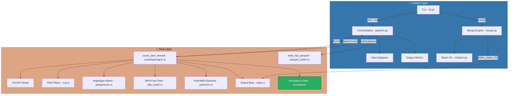
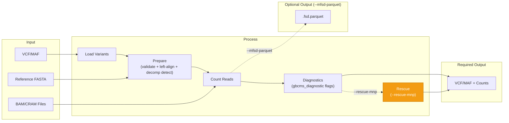
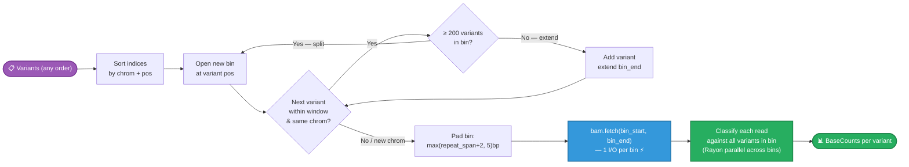
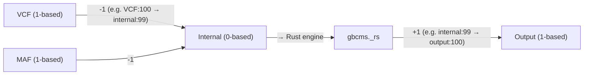
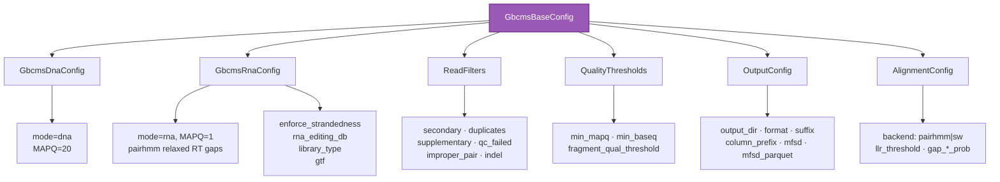
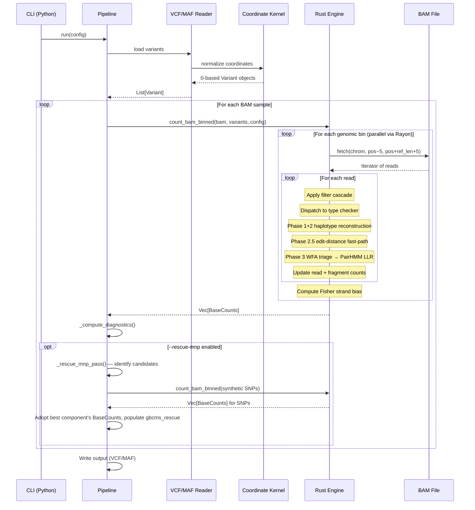
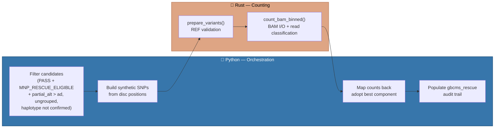

# Architecture

gbcms uses a hybrid Python/Rust architecture for maximum performance.

## System Overview



---

## Data Flow



---

## Genomic Binning

To minimise BAM I/O, the Rust engine groups co-located variants into **genomic bins** before counting. A single `bam.fetch()` is issued per bin, and reads fetched for that region are classified against **all variants in the bin** in one pass. For clustered inputs (e.g. a MAF with hundreds of variants on the same gene) this reduces BAM seeks from O(N) per-variant to O(B) per-bin — typically 5-20× fewer I/O operations.

This design mirrors the original C++ GBCMS `--max_block_size` / `--max_block_dist` architecture, re-implemented as a pure Rust streaming algorithm.



### Binning Parameters

| Parameter | Value | Notes |
|:----------|:------|:-------|
| `BIN_WINDOW` | **10,000 bp** | A floor, not a maximum. A bin covers at least this span from its first variant (and that variant's whole REF span); each variant added extends its end to the variant's span plus half a window, so variants closer than that chain the bin further. A variant at or past the end starts a new bin. |
| `BIN_MAX_VARIANTS` | **200** | Maximum variants per bin. Split enforced to prevent O(V × R) blowup in the shared-read classification loop; in dense inputs it, not the span, ends a bin. |
| Bin padding | `max(repeat_span + 2, 5)` bp | Ensures reads overlapping bin edges are captured. Uses each variant's detected tandem-repeat span. |
| Parallelism | Rayon `par_iter()` over bins | Each thread owns its own `BamReader` handle; no locking required across bins. |
| Output order | Preserved | Variants are sorted by index internally; results are written back in original input order. |

!!! tip "Performance Implication"
    For a MAF with 500 variants on *TP53* (a 19kb gene), the engine produces 3 bins (the 200-variant cap) instead of 500 individual `bam.fetch()` calls. On high-depth targeted panels this can reduce wall-clock counting time by 5-20×.

!!! info "The bin span is a soft floor; it is never capped"
    Measured by replaying the rule on real inputs (2026-10-05): per-sample variant lists
    (141,845 samples, 1.04M bins) have a median span of 10 kb, p99 11.6 kb and a maximum
    of 29 kb (1.6% of bins past the window, none split at the variant cap). One input
    holding a whole cohort's variants chains further: the ACCESS union (14,296 variants)
    reaches p99 36 kb, max 47 kb (4.7x the window); the IMPACT union (424,572 variants)
    p99 23 kb, max 44 kb, where the 200-variant cap ends 1,458 bins first.

    The span only sets how much one fetch reads. It is not capped: a bin's fetch must
    hold every member's full read window, the anchor variant's included (a cap that cut
    the end short dropped reads aligned past a long deletion).

!!! info "Not a CLI flag"
    `BIN_WINDOW` and `BIN_MAX_VARIANTS` are internal performance constants — they do not affect output values. Binning invariance holds them to that: every count is identical under any bin window or cap, one variant per bin, or one variant per call (`tests/test_binning_invariance.py`, a Rust property test, and the per-variant check in every counting test).

---

## Coordinate System

All coordinates normalized to **0-based, half-open** internally:



| Format | System | Example |
|:-------|:-------|:--------|
| VCF input | 1-based | chr1:100 |
| Internal | 0-based | chr1:99 |
| Output | 1-based | chr1:100 |

---

## Formulas

### Variant Allele Frequency (VAF)

```
VAF = AD / (RD + AD)
```

Where:
- **AD** = Alternate allele read count
- **RD** = Reference allele read count

### Strand Bias (Fisher's Exact Test)

```
         |  Forward  Reverse  |
    -----+--------------------+
    Ref  |    a        b      |
    Alt  |    c        d      |
    -----+--------------------+
    
    p-value = two-sided exact Fisher test (R's fisher.test), any depth
```

Low p-value (< 0.05) indicates potential strand bias artifact; at deep coverage, read
the odds ratio for the size of the imbalance.

### Structural Invariants

The Rust counting engine (`BaseCounts`) maintains these invariants at all times:

| Invariant | Formula | Purpose |
|:----------|:--------|:--------|
| ALT decomposition | `any_alt = AD + partial_alt` | any_alt decomposes into full ALT matches and partial-only matches |
| ALT monotonicity | `any_alt >= AD` | Reads with any ALT evidence ≥ reads with full ALT match |
| Depth decomposition | `DP >= RD + AD + partial_alt + n_count` | DP includes all read categories; gap = reads classified as neither |

### Diagnostic Output Fields

Three diagnostic fields are always present in VCF (FORMAT tags) and MAF output:

| Field | VCF Tag | Description |
|:------|:--------|:------------|
| `any_alt` | `AAD` | Reads with ALT evidence at ≥1 discriminating position |
| `partial_alt` | `PAD` | Reads matching ALT at some but not all positions — now populated for all variant types including INDELs (via structural evidence propagation) |
| `n_count` | `NAD` | Reads with N base at ≥1 discriminating position (duplex masking QC) |

N bases are **strictly uninformative** — they increment `n_count` for QC monitoring but are excluded from RD, AD, any_alt, and partial_alt. See [Counting Metrics](counting-metrics.md) for full details.

---

## Module Structure

```
src/gbcms/
├── cli.py           # Typer CLI (dna, rna, merge, normalize, convert commands)
├── pipeline.py      # Orchestration (~450 LOC)
├── merge.py         # Multi-BAM MAF merge engine (Polars lazy joins)
├── normalize.py     # Standalone normalization workflow
├── convert.py       # Standalone VCF <-> MAF conversion (vcf2maf / maf2vcf)
├── qc_summary.py    # End-of-run QC summary (log block read from the written output)
├── qc_export.py     # `gbcms summarize`: the QC summary as text, JSON, a cohort TSV or MultiQC content
├── core/
│   └── kernel.py    # Coordinates + VCF <-> MAF representation, type labels
├── io/
│   ├── input.py     # VcfReader, MafReader (streaming)
│   ├── output.py    # VcfWriter, MafWriter (mode-aware: DNA/RNA columns)
│   ├── reference.py # Reference bases for MAF -> VCF anchors
│   └── batch.py     # Polars batch I/O (read/scan/write MAF, read Parquet)
├── models/
│   └── core.py      # Pydantic configs (GbcmsDnaConfig, GbcmsRnaConfig, MergeConfig)
└── utils/
    └── logging.py   # Structured logging

rust/src/
├── lib.rs                    # PyO3 module exports
├── annotation/               # v5.0.0: GTF annotation index (COITree, splice masks)
│   ├── mod.rs                # AnnotationIndex struct, COITree queries
│   ├── gtf.rs                # GTF loader (plain or gzip/BGZF, variant-guided streaming)
│   └── gtf_line.rs           # One GTF line's exon fields (noodles-gtf's grammar)
├── counting/
│   ├── mod.rs                # Submodule re-exports
│   ├── engine.rs             # Main loop, genomic binning, BAQ, UMI
│   ├── variant_checks.rs     # check_snp/mnp/ins/del/complex + Phase 3 dispatch
│   ├── alignment.rs          # Smith-Waterman implementation
│   ├── pairhmm.rs            # PairHMM alignment backend (marginalized)
│   ├── pangenome.rs          # Haplotype matrix construction
│   ├── wfa_router.rs         # WFA2 fast-path alignment
│   ├── rna.rs                # RNA validation, splicing, editing site lookup
│   ├── fragment.rs           # Re-export of shared::fragment (backward compat)
│   ├── mfsd.rs               # Mutant Fragment Size Distribution analysis
│   ├── parquet_writer.rs     # write_fsd_parquet() — native Parquet via ZSTD
│   └── utils.rs              # Helpers, reconstruction, soft-clip
├── normalize/
│   ├── mod.rs                # Submodule re-exports
│   ├── engine.rs             # Normalization pipeline
│   ├── left_align.rs         # bcftools-style left-alignment
│   ├── decomp.rs             # Homopolymer decomposition
│   ├── fasta.rs              # Reference sequence fetcher
│   ├── repeat.rs             # Tandem repeat detection
│   └── types.rs              # NormResult enum
├── shared/
│   ├── mod.rs                # Submodule re-exports
│   ├── fragment.rs           # FragmentEvidence, quality consensus, UMI grouping
│   ├── stats.rs              # Fisher's exact test (strand bias), BH correction
│   ├── filters.rs            # ReadFilter struct, FilterCounts (BAM flag checks)
│   ├── baq.rs                # BAQ heuristic (Li 2011)
│   └── bam_utils.rs          # median_qual, find_read_pos
└── types.rs                  # Variant, BaseCounts, PyO3 bindings
```

---

## Configuration

All settings via mode-specific Pydantic models:



See [models/core.py](https://github.com/msk-access/gbcms/blob/main/src/gbcms/models/core.py) for definitions.

---

## Full Pipeline: End-to-End Example

Here's how a single variant is processed through the complete pipeline:



---

## MNP Rescue Pass (`--rescue-mnp`, v4.3.0)

Rescue is for annotated MNPs whose carriers hold only a **component** of the haplotype —
typically SNVs on different molecules (trans, separate subclones, or a merged-SNV
annotation). The MNP check correctly reports such a haplotype as absent: each carrier
matches ALT at some discriminating positions and REF at others, so it lands in
`partial_alt`. Rescue re-counts every discriminating position as an SNV and reports the
best-supported component. In RNA mode with `--gtf`, each component is counted over its
MNP's REF span for the exon-edge BAQ rule, so the components and the MNP row are counted
under one rule and a rescued row reports the MNP's `exon_boundary_dist`.

### Why Python, Not Rust?

The original design spec proposed implementing rescue in Rust. The final implementation
uses **Python orchestration calling the existing Rust counting engine**. This was a
deliberate architectural decision:



| Concern | If implemented in Rust | Actual (Python + Rust) |
|:--------|:----------------------|:-----------------------|
| **BAM I/O** | Rust (fast) | **Rust** via `count_bam_binned()` — same speed |
| **Read classification** | Rust (fast) | **Rust** — unchanged |
| **Candidate filtering** | Would duplicate Python diagnostic logic | **Python** — direct access to `gbcms_diagnostic` |
| **Synthetic variant creation** | New Rust API surface needed | **Python** — uses existing `rs.Variant()` |
| **Config access** | Entire config struct across FFI boundary | **Python** — `self.config.*` already available |
| **Audit trail formatting** | Awkward string manipulation in Rust | **Python** — natural |
| **Unit testing** | Hard to mock BAM interactions | **Python** — `SimpleNamespace` mocks |
| **Performance impact** | Negligible improvement | **< 1 second** added to 30–120s pipeline |

!!! info "Key Insight"
    The rescue engine is an **orchestration layer**, not a counting engine. The expensive
    work (BAM I/O, read classification, allele counting) is still 100% Rust. Python
    decides _what_ to re-count and _what to do_ with the results — typically 5–50
    synthetic SNPs per sample, handled in a single batched `count_bam_binned()` call.

### Rescue Candidate Criteria

A variant is a rescue candidate when **all** conditions are met:

| # | Condition | Rationale |
|:--|:----------|:----------|
| 1 | `gbcms_status` is `PASS` | FAIL variants have unreliable coordinates |
| 2 | `MNP_RESCUE_ELIGIBLE` in `gbcms_diagnostic` | Emitted only for MNPs (`ref_len == alt_len > 1`) with disc/len ≤ `--rescue-mnp-threshold` (default 1.0 = all MNPs; 0.5 = conservative sparse-only mode). |
| 3 | `partial_alt > ad` | The haplotype is dominated by component evidence. Not `ad == 0`: masked per-position evaluation counts a component carrier whose other discriminating base is low-BQ as full ALT, and one such read must not block rescue. |
| 4 | Not in a co-annotated group (`multi_allelic_group` unset) | Grouped reads are exclusively assigned against siblings; a sibling-free component re-count would hand contested reads back. Such rows get `outcome=skipped_grouped`. |
| 5 | `mnp_confirmed_alt == 0` | `mnp_confirmed_alt` counts MNP ALT reads in which every discriminating base was read (none masked, none N) — reads that *show* the whole haplotype. A read with an indel inside the block never counts: its sequence at the locus is a different allele, not the annotated one (the complex path may still count it toward `ad`, which makes condition 3 harder to meet). Any such read means the BAM shows the annotated allele (e.g. a somatic change on a germline SNP's haplotype), and adopting a component would report a different allele, so the row keeps the MNP's counts with `outcome=haplotype_confirmed` and no re-count. Every correct rescue seen in real data had zero such reads; an error-made one needs a specific high-quality substitution at another changed base. (An error allowance scaled by `partial_alt` was tried and rejected: on ACCESS it adopted a germline SNP.) |

### Rescue Strategy: Adopt the Best Component

```
MNP:  GAGGG → AAGGA  (5bp; discriminating offsets 0 and 4 → 2/5)
MNP evaluation: ref 486, alt 1, partial_alt 88   (carriers hold only the first G>A;
                                                   counts illustrative, TERT-shaped)

Components, counted as SNVs with the sample's own settings:
  1:1000 G>A  → ad=88
  1:1004 G>A  → ad=1

Best component beats the MNP's ad (88 > 1) → the row reports the 1:1000 G>A SNV's
BaseCounts wholesale.
gbcms_rescue: method=decomposed;outcome=rescued;original_ref=486;original_alt=1;
              original_partial=88;original_confirmed=0;adopted=1:1000(G>A);
              positions=1:1000(G>A):88+1:1004(G>A):1
```

Ties go to the leftmost position. Adopting the component's **whole** `BaseCounts` (not
just its `ad`) keeps the row one coherent genotype: every count, fragment, strand,
strand-bias, mFSD and RNA column comes from one counting pass, so all counting invariants
hold, and `gbcms_diagnostic` is recomputed from the adopted counts. Grafting only the ALT
side onto the MNP record would mix two classifications — fragment consensus lets a
neither-read abstain, so one fragment can be MNP-REF and component-ALT at once.

Consequences to keep in mind when reading a rescued row:

- `ref_count` / `total_count` are the component's: reads carrying only *another*
  component count as REF at the adopted position, and reads covering that position
  without spanning the whole block count toward depth.
- A component can be a germline SNP merged into a somatic MNP. Where reads show the
  MNP, rescue keeps it (criterion 5); where the MNP is absent (e.g. a fillout of other
  timepoints or normals), the germline component can still be adopted and the row's VAF
  is then the germline VAF. `gbcms_rescue` shows the per-position split.
- With `--apply-baq`, BAQ can lower base qualities near indels so a read carrying the
  whole MNP stops counting as showing it (a changed base is masked). Unobserved on the
  validation data (no candidate MNP sat next to an indel), but at such loci read
  `original_confirmed` in `gbcms_rescue` with care.
- Labels (`RESCUED_COMPONENT`, the audit, logs) use the contig as the output row writes
  it — an input MAF's own `Chromosome` (e.g. `chr1`).
- `gbcms merge` with duplex + simplex: when the two flavors' rescue outcomes differ, each
  row is named in a WARNING — the `simplex_duplex_*` columns then add counts of different
  alleles — with a per-run count; counts are left unchanged.
- With `--observations-parquet`, the Parquet records the MNP evaluation; a rescued row's
  counts come from the adopted component (logged per sample).
- With `--mfsd-parquet`, a rescued row's record keeps the MNP's coordinates but carries the
  adopted component's fragment sizes — consistent with the row's mFSD columns; join to the
  MAF/VCF `gbcms_rescue` to tell rescued rows apart (logged per sample).

### Audit Trail (`gbcms_rescue`)

`gbcms_rescue` is empty for non-candidates and is reset for every sample (the prepared
variant list is shared across the BAMs of a run). For candidates:

<!-- Defined once, in QC Flags; this includes that table. -->
--8<-- "reference/qc-flags.md:rescue"

`MNP_DISC_RATIO(n/m)` and `MNP_RESCUE_ELIGIBLE` describe the annotated MNP's *shape*, so a rescued row keeps them next to `RESCUED_COMPONENT(...)`: rows still awaiting review after a rescue run are those with `MNP_RESCUE_ELIGIBLE` and **without** `RESCUED_COMPONENT` (equivalently, `gbcms_rescue` `outcome` other than `rescued`). The flags: [QC Flags → Diagnostics](qc-flags.md#diagnostics).

`original_ref` / `original_alt` / `original_partial` / `original_confirmed` always carry the
MNP's own counts (`original_confirmed` is its `mnp_confirmed_alt`).
A position whose synthetic SNV failed preparation is listed as `…:ref_fail`, never `0`.
Positions are joined with `+`, never `,`: the VCF carries this string as the Number=1 `GR`
INFO value (with `;` written as `|`), and VCF parsers split values at commas. The MAF
column and the VCF `GR`/`GD` values carry identical content.

## Comparison with Original GBCMS

| Feature | Original GBCMS | gbcms |
|:--------|:---------------|:---------|
| Counting algorithm | Region-based chunking, position matching | Per-variant CIGAR traversal |
| Indel detection | Exact position match only | **Windowed scan** (±5bp) with 3-layer safeguards: sequence identity, closest match, reference context validation |
| Complex variants | Optional via `--generic_counting` | Always uses haplotype reconstruction |
| Complex quality handling | Exact match only (no quality awareness) | **Masked comparison** — bases below `--min-baseq` are masked out, ambiguity detection prevents false positives |
| Base quality filtering | No base quality threshold | Default `--min-baseq 20` (Phred Q20) |
| MNP handling | Not explicit | Dedicated `check_mnp` with contiguity check |
| Fragment counting | Optional (`--fragment_count`), majority-rule | Always computed, quality-weighted consensus with INDEL structural priority |
| Positive strand counts | Optional (`--positive_count`) | Always computed |
| Strand bias | Not computed | Fisher's exact test (read + fragment level) |
| Fractional depth | `--fragment_fractional_weight` | Not implemented |
| Parallelism | OpenMP block-based | Rayon per-variant |

### Known differences from GetBaseCountsMultiSample 1.2.5

The table above is the design. The list below is what the counts show. Each difference was
found by tracing every read that moves a count, on the eight HG002 benchmark arms (GIAB HG002,
NovaSeq 35x, GRCh38; 400 to 14,949 rows each; the arms are described in
`docs/harness/measurement-harness.md`). The numbers are HG002 reads and rows. Of the 53,469
reads that move a count, 2 have no reason yet.

The run behind the numbers, so it can be repeated:

- **The original:** GetBaseCountsMultiSample built from its tag `v1.2.5`, with a per-read trace
  added in a scratch copy (its output equals the release build's on every row checked), run as
  `--maq 20 --baq 20 --filter_duplicate 1 --filter_qc_failed 1 --filter_non_primary 1`, once with
  its default counting and once with `--generic_counting`.
- **gbcms:** the `develop` commit `fe34f443` (the 6.7.0 development build `c62fd`), the default
  rules path, with `--trace`, at its defaults (MAPQ 20, base quality 20, the duplicate,
  QC-failed, secondary and supplementary filters on).
- **When:** 2026-10-30, on the HPC cluster, one run per arm and tool.

The numbers describe that commit. A later change to a counting rule can move them, so repeat the
comparison on the build you use before relying on a figure.

- **Supplementary alignments.** 1.2.5's `--filter_non_primary` removes secondary alignments only
  (`0x100`), so a read with a supplementary segment counts twice in depth, `REF` and `ALT`; gbcms
  never counts either as a read. HG002: 2,044 reads in the depth of 516 SNV rows, 955 `REF` reads
  (315 rows), 1,046 `ALT` reads (226 rows); 1,920 and 1,230 reads in the depth of 396 insertion and
  268 deletion rows. See [Filter Options](read-filters.md#filter-options).
- **Base quality under the limit.** With a limit set, 1.2.5 leaves a read whose deciding base is
  under it out of depth (for an indel, the base after the anchor); gbcms masks the base and keeps
  the read in depth. HG002: 29,771 reads in 8,975 SNV rows; 1,028 reads in 395 insertion rows, 268
  in 129 deletion rows, 93 in 30 complex rows. See [Quality Thresholds](read-filters.md#quality-thresholds).
- **Bases past the fragment end.** gbcms clips adapter bases at the fragment end before counting
  ([RJ-10](read-judgment.md#decided)); 1.2.5 counts them. HG002 has few (14 `REF` and 3 `ALT` reads in SNV rows, 29 depth reads
  in insertion rows); short-insert libraries (panel, cfDNA) have more. See
  [Filter Cascade](read-filters.md#filter-cascade).
- **A read that holds a listed sibling's `ALT` is not `REF`.** gbcms leaves it out of this row's
  `REF`; 1.2.5 counts bases, so the read stays `REF` ([RJ-5](read-judgment.md#decided)). HG002: 411 `REF` reads in 134 SNV
  rows, 14 in 7 MNV rows; a sibling row takes 470 insertion and 202 deletion reads that 1.2.5 gives
  to `ALT`. See [Sibling ALT exclusion](allele-classification.md#phase-2-sibling-alt-exclusion).
- **The row's event plus another change is another allele.** 1.2.5 calls a read `ALT` when its
  CIGAR holds an indel of the right length (for an insertion, the right bases) right after the
  anchor, whatever else the read carries; gbcms judges the read's bases over the whole window
  ([RJ-7, RJ-25](read-judgment.md#decided)). HG002, where gbcms `ALT` is lower: 367 insertion rows (2,938 reads) and 167 deletion rows
  (1,361 reads), 79% of them this case. See [The exact-carrier rule](allele-classification.md#the-exact-carrier-rule).
- **What 1.2.5 counts as `REF` at an indel.** A read whose block covers the anchor is `REF` when
  the base after the anchor is the reference, even if the read holds the indel elsewhere in the
  repeat; any other base after the anchor makes it noise (in depth, not `REF`). gbcms counts `REF`
  only from reads that tell the alleles apart. HG002: gbcms `REF` is higher in 513 insertion rows
  (4,587 reads, 76% with another base right after the anchor) and 141 deletion rows (355 reads), and
  lower in 3,656 insertion and 2,310 deletion rows (reads that do not tell the alleles apart). See
  [Informative Reads for Indels](allele-classification.md#informative-reads-for-indels).
- **The window opens one base right of the anchor.** 1.2.5 counts a read that starts at
  anchor+1 in the depth of an insertion or deletion; gbcms counts depth over reads that cover the
  anchor, with two exceptions, both for a read whose allele its own bases decide:
    - A read whose allele lies in its soft-clipped bases counts although its aligned span stops
      short of the anchor. DNA only, and only when every base read lies inside a well-defined
      fragment ([RJ-13](read-judgment.md#decided): soft-clipped bases are the read's own).
    - A read decided from windows read from the right flank counts although it starts past the
      variant position, as the other allele's molecule starting there would (both modes;
      [RJ-23](read-judgment.md#decided)).

    Both apply wherever a read is judged from its own bases: the
    [exact-carrier rule](allele-classification.md#the-exact-carrier-rule), the
    [junction judge for deletions of 50 bp or more](allele-classification.md#deletions-of-50-bp-or-more)
    and `--read-judge sequence`. The HG002 numbers are reads that 1.2.5 puts in depth and gbcms does
    not, so reads admitted this way are not among them. HG002: 9,989 reads in 2,008 insertion rows,
    620 in 320 deletion rows, 16 in 10 complex rows. This is most of the lower gbcms depth at
    insertions. See [Fetch Window](read-filters.md#fetch-window).

- **MNV.** 1.2.5 drops a read from depth when any base of the block is under the limit, needs the
  whole block to equal `REF` or `ALT`, needs one aligned block, and counts a read that starts inside
  the block in depth. gbcms masks each differing position on its own, ignores positions the alleles
  share, and judges a read with an indel beside the block by the exact-carrier rule. HG002 has 21
  padded MNV rows: 58 reads (13 rows) dropped for a low base, 23 `REF` reads (4 rows) that fail the
  whole-block test, 32 reads (12 rows) that start inside the block. See
  [MNP](allele-classification.md#mnp-multi-nucleotide-polymorphism).
- **Complex rows.** 1.2.5's default path treats a delins as an insertion or deletion by length and
  matches only the CIGAR indel, so a read whose aligner wrote the change another way is `REF`;
  `--generic_counting` compares bases and finds some of them. gbcms always rebuilds the haplotype.
  HG002: 446 rows differ, with gbcms `ALT` higher in 432. See
  [Complex](allele-classification.md#complex-indel-substitution).
- **`--generic_counting` beside an insertion.** In 1.2.5's generic mode a read's allele includes an
  insertion directly before or after its base, so a SNV next to an insertion loses those reads from
  `REF` and `ALT` (they stay in depth). HG002: 877 of 15,288 SNV rows differ between the two modes
  of 1.2.5, all next to an insertion (6,604 reads before, 821 after). Do not take its generic mode
  as the reference for `REF` there.
- **Fragment counts.** 1.2.5 uses the majority rule, gbcms a quality-weighted consensus. Fragment
  `REF` and `ALT` follow the read-level differences above, and the fragment total follows depth.
  HG002: SNV fragment `REF` and `ALT` agree in 97% and 98% of rows. See
  [Counting Metrics](counting-metrics.md).
- **Rows.** 1.2.5 writes counts for an ALT of `*` (an overlapping deletion), and its MAF merges
  repeats of one variant in one BAM; gbcms skips `*` and writes one row per input row. HG002: 1,807
  `*` rows in the VCF sets. To compare row for row, drop the `*` rows and merge the repeats. See
  [Input Formats](input-formats.md#alt-alleles).
- **A defect of 1.2.5, not a gbcms rule.** Near a boundary of the BAM index's 16 kb bins, the
  BamTools 2.3.0 index lookup bundled with 1.2.5 can start past reads that overlap the start of a
  block's region, so 1.2.5's depth and counts are too low at those rows. If gbcms has the higher
  depth at a row near a bin boundary, check this first.

---

## Related

- [Allele Classification](allele-classification.md) — How each variant type is counted
- [RNA Annotation](rna-annotation.md) — GTF annotation, per-transcript counting, ASJD detection
- [RNA Splice-Junction Handling](rna-splice-handling.md) — How gbcms handles splice-boundary artifacts vs GATK SplitNCigarReads
- [Variant Normalization](variant-normalization.md) — How variants are prepared before counting
- [Input Formats](input-formats.md) — VCF and MAF specifications
- [Glossary](glossary.md) — Term definitions
