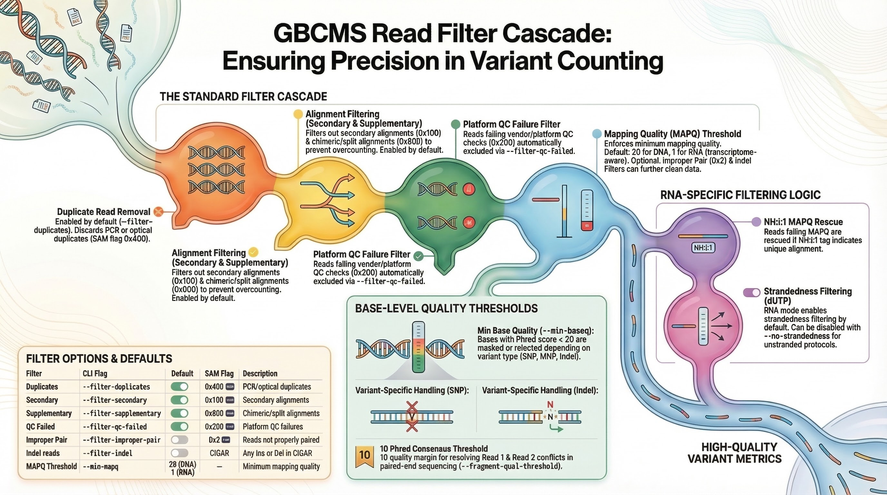
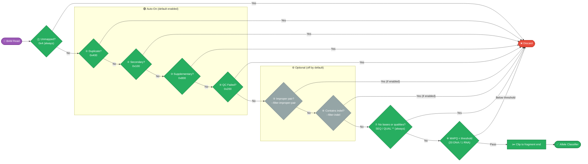
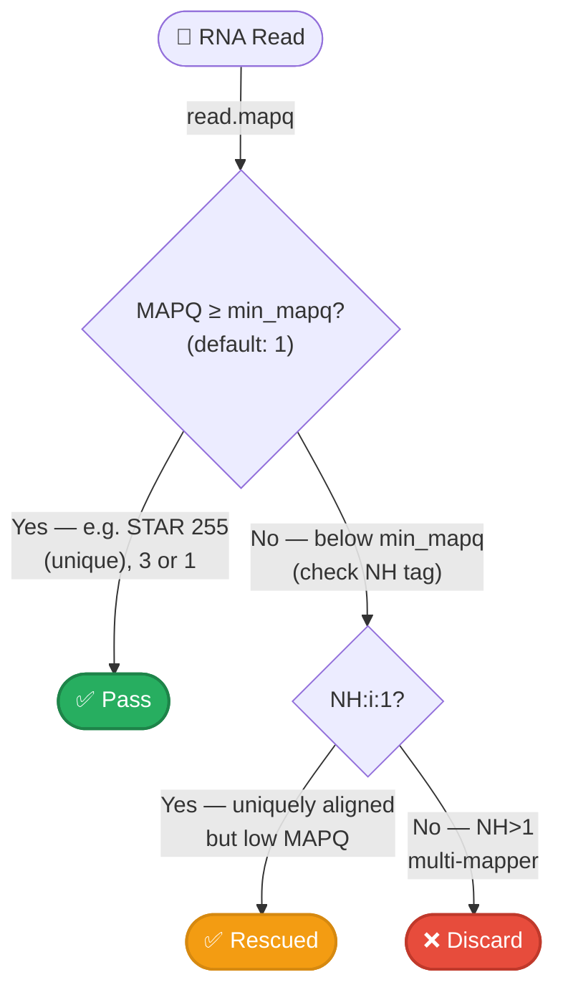

# Read Filters

Which reads are excluded before allele classification — the filter cascade, CLI flags, and defaults.

!!! info "Visual Overview"
    <figure markdown="span">
      { loading=lazy width="100%" }
      <figcaption>The read-filter cascade and counting metrics — click to enlarge</figcaption>
    </figure>

## Filter Cascade

Every read from the BAM passes through a **filter cascade** before being checked for allele support. Reads failing any enabled filter are discarded. The order matches the Rust engine implementation.



**Unmapped records.** A record flagged unmapped (0x4) is not an alignment. An
aligner places it at its mate's position with MAPQ 0, sometimes with a CIGAR, so
it would otherwise reach a variant there: in `mq0_count` by default, and as a read
at `--min-mapq 0`. It is always dropped first (step ⓪), in every mode. Its mapped
mate still counts (one mapped read of a pair is a read), and mapped MAPQ-0
alignments stay countable at `--min-mapq 0`, as pseudogene loci such as PMS2 need.
samtools/bcftools mpileup and GATK (MappedReadFilter) drop unmapped reads too.

**Records without bases or qualities.** A record stored with no sequence
(SEQ `*`) shows no allele. Aligners write some secondary alignments this way, and
a stripped BAM can hold primaries like it. A record with bases but no qualities
(QUAL `*`, stored as 0xFF bytes) gives its bases no error rate, so no rule can
weigh them (GATK's WellformedReadFilter rejects it too). Either is always dropped
right after the flag filters (step ⑦), in every mode and counting path, and
counted in neither depth, fragments nor `mq0_count`. Each counting pass logs one
WARNING for each kind, with the number of bin fetches that skipped one (bin
windows overlap, so a record can count more than once).

**A read ends at its fragment end.** When the insert is shorter than the read,
the read runs on past its mate's 5' end into adapter (read-through). For a pair
whose fragment is well defined (mate mapped on the same contig, the pair facing
inward), the bases past the fragment end are hard-clipped as the read enters the
counting pass, as if the read had been trimmed, so no rule sees them as bases or
as reach, and a reverse read's start moves past any aligned bases it loses. TLEN
is read as BWA-MEM, samtools fixmate and Picard write it, from the forward read's
5' end to the reverse read's, positive on the forward read; an outward-facing
pair (as at a tandem-duplication junction) defines no fragment. Tags are kept.
Only adapter-like bases are clipped: soft-clipped, or at most two aligned past
the boundary (an aligner's chance extension into adapter), none inserted. A read
whose bases go on aligning past the boundary, or hold an insertion there, keeps
them: TLEN is a reference distance, so it leaves out the inserted bases of an
ITD and a mate's clipped 5' bases, and those bases are the molecule's. GATK hard-clips adapter at the same
boundary, and fgbio ClipBam's `--clip-bases-past-mate` does it as a separate step.
See [Read Judgment](read-judgment.md) (RJ-10 to RJ-12).

---

## Filter Options

| Filter | CLI Flag | Default | SAM Flag | Description |
|:-------|:---------|:--------|:---------|:------------|
| Duplicates | `--filter-duplicates` | **On** | `0x400` | PCR/optical duplicates |
| Secondary | `--filter-secondary` | **On** | `0x100` | Secondary alignments (see note) |
| Supplementary | `--filter-supplementary` | **On** | `0x800` | Chimeric/split alignments (see note) |
| QC Failed | `--filter-qc-failed` | **On** | `0x200` | Platform QC failures |
| Improper Pair | `--filter-improper-pair` | Off | `0x2` (inverted) | Reads not properly paired |
| Indel reads | `--filter-indel` | Off | CIGAR-based | Any Ins or Del in CIGAR |
| MAPQ threshold | `--min-mapq` | **20** (DNA) / **1** (RNA) | — | Minimum mapping quality |

!!! note "Secondary and supplementary affect fragment counts, never read-level depth"
    These two behave differently from the rest. A secondary or supplementary alignment
    shares a QNAME with its primary, so it is **never** a first-class read-level
    observation: it does not contribute to `dp`, `rd` or `ad` however the flags are set.
    Counting one would report two reads where a single physical read exists.

    Turning the filter **off** admits them to **fragment**-level evidence (`dpf`, `rdf`,
    `adf`) and to the [per-molecule observation export](molecule-observations.md). That
    cannot double-count — fragments are keyed by QNAME hash, so a primary and its
    supplementary collapse into one — and it is what makes a locus reached *only* by a
    supplementary segment visible at all. Such a locus otherwise reports `dpf=0` despite a
    molecule demonstrably covering it, which is why a molecule spanning a large deletion
    was invisible to cross-locus phasing.

    Consequence worth knowing: with the filter off, an admitted supplementary raises `dpf`
    while leaving `dp` unchanged. The two measure different things and stop moving together.

!!! danger "`--filter-improper-pair` can discard everything"
    Some UMI-collapsed pipelines emit reads with **no `PROPER_PAIR` flag at all** — measured
    at 0.0% across every alignment type in one MSK-ACCESS version, despite 100% of reads
    being paired. Enabling this filter there removes **every read**, silently. It defaults
    to off for that reason.

---

## Quality Thresholds

Beyond the read-level filters above, gbcms also applies **base-level quality thresholds** during allele classification:

| Parameter | CLI Flag | Default | Description |
|:----------|:---------|:--------|:------------|
| Min base quality | `--min-baseq` | **20** | Bases below this are read as unknown (like `N`); reads are kept |
| Fragment consensus threshold | `--fragment-qual-threshold` | **10** | Quality margin for R1/R2 conflict resolution |

!!! info "What `--min-baseq` does"
    A base below `--min-baseq` is read as unknown, exactly like an `N`: it supports no
    allele and counts against none. The threshold masks bases, never reads. A read with
    masked bases still counts toward depth (`DP`, `DPF`) and is classified on its other
    bases; when those cannot tell REF from ALT, it counts toward depth only (neither REF
    nor ALT). `--min-baseq 0` masks only `N` bases. With `--apply-baq`, qualities near
    indels and splice junctions are lowered first, then compared with the threshold
    (see [BAQ](#baq-quality-downgrade)).

    By variant type:

    - **SNP**: a masked base at the variant position leaves the read neither REF nor ALT.
    - **MNP**: each position where REF and ALT differ is judged on its own. Masked
      positions are skipped and the confident ones decide; a read with every differing
      position masked counts toward depth only.
    - **Insertion/Deletion**: masked bases match any base when the read is compared with
      each allele. A masked base's identity is unknown, but the base is still there.
      So an insertion read whose inserted bases are all masked still shows the
      insertion's length: inside the discrimination window, an insert of the ALT's
      length is the ALT where no other allele of that length is at the locus (RJ-20 in
      the [read-judgment register](read-judgment.md)). The CIGAR checks, used only for an
      insertion without a prepared reference, count it neither, in `partial_alt`.
    - **Complex (exact carriers)**: Bases at or above the threshold must match the allele; every base is also weighed by its quality, and an ALT call needs the read's evidence for ALT over REF to reach at least what one base at the threshold gives (about 2.5 log10 at 20), so a read whose window is mostly low quality cannot be called ALT on one clear base
    - **Complex (Phase 3 SW)**: Low-quality bases are replaced with `N`, which scores 0 against any base

    The original GBCMS applies no base-quality threshold by default; when one is set, a
    read whose deciding base falls below it is left out of depth (`DP`) as well. gbcms
    keeps such a read in depth.

---

## Comparison with Original GBCMS

!!! note "Filter Non-Primary"
    The original GBCMS has a single `--filter_non_primary` flag (default off), and it removes **secondary** alignments only (SAM flag `0x100`, tested with BamTools' `IsPrimaryAlignment`). It never removes a supplementary alignment (`0x800`): with the flag on or off, a read's supplementary records stay and are counted in depth, `REF` and `ALT` like any other read that passes the original's other filters, so one physical read can count twice. gbcms splits the filter into `--filter-secondary` and `--filter-supplementary`, both **on** by default, and a secondary or supplementary record is never a read-level observation (see [Filter Options](#filter-options)). For the counts this changes, see the [known differences from 1.2.5](architecture.md#known-differences-from-getbasecountsmultisample-125).

| Feature | Original GBCMS | gbcms |
|:--------|:---------------|:---------|
| Base quality filtering | No threshold | Default `--min-baseq 20` |
| Duplicate filtering | Optional | **On** by default |
| Non-primary filter | Single flag, secondary (`0x100`) only; supplementary always kept (default off) | Split: secondary + supplementary (**both On**), neither a read-level observation |
| QC-failed filter | Optional | **On** by default |
| Indel read filter | Optional | Optional (off by default) |

---

## Fetch Window

gbcms fetches reads from a **dynamic window** around each variant position — not just at the exact position. The window defaults to ±5bp but **scales with the variant's repeat span** to capture indels that aligners shift beyond 5bp in long homopolymers and microsatellite regions. The formula is `max(5, repeat_span + 2)`.

```
Variant: chr1:100 A→ATG (insertion, repeat_span=0)
BAM fetch window: [95, 106)    ← ±5bp (default)

Variant: chr1:200 A→AT (insertion in 15bp poly-A, repeat_span=15)
BAM fetch window: [183, 206)   ← ±17bp (repeat_span + 2)
```

!!! important "Anchor Overlap Gate"
    Although reads are fetched from the wider window, **only reads that overlap the variant's anchor position** (or are classified as REF/ALT via shifted indel matching) contribute to the DP count. This prevents DP inflation from reads that were brought in by the window padding but don't actually cover the variant. Two kinds of read count although they miss the anchor, both decided from their own bases: a read whose allele lies in soft-clipped bases (DNA) and a read decided from windows read from the right flank (see [Known differences from 1.2.5](architecture.md#known-differences-from-getbasecountsmultisample-125)).

    ```
    Read A: [90─────100]        → overlaps anchor at 100 → counted in DP ✅
    Read B: [92──97]            → doesn't overlap 100, not classified → skipped ❌
    Read C: [95──99] + shifted  → doesn't overlap 100, but windowed scan found ALT → counted ✅
    ```

---

## RNA-Specific Filters

RNA mode (`gbcms rna`) extends the standard filter cascade with two additional checks.

### NH:i:1 MAPQ Rescue

STAR's MAPQ depends only on how many loci a read aligns to equally well: 255 for
one, 3 for two, 1 for three or four, 0 for five or more. When `--min-mapq 1` (RNA
default), reads that fail the MAPQ threshold are checked for the `NH:i:1` tag
(Number of Hits = 1). If present, the read is uniquely aligned and rescued.



!!! info "When the rescue applies"
    For STAR an `NH:i:1` read is always MAPQ 255, so the rescue matters for
    aligners whose MAPQ can be low for a uniquely aligned read; it keeps those
    reads in the counts rather than silently discarding them.

### Why the RNA default is `--min-mapq 1`

The RNA default keeps reads STAR placed at two to four loci (MAPQ 3 or 1), each
counted once, at its primary alignment (secondary alignments are filtered). This
is deliberate (operator, 2026-10-03), because junction reads tie between a gene
and its processed pseudogene: a spliced read from the parent gene aligns equally
well, unspliced, to the intronless retrocopy.

Measured on the FORTE truth set (33 samples, 94 rows) and the STAR probes (3
samples, 978 rows), with the counts at the default as the reference:

| Threshold | What it keeps | Effect |
|:--|:--|:--|
| `--min-mapq 255` (unique only) | one locus | Truth: ALT −12, REF −25, depth −83. PIK3CA E545K (exon 9, which has a pseudogene copy on chr22) loses 10 of 159 ALT reads. Probes: depth −2.2%, ASJD junction fragments −1.6% |
| `--min-mapq 1` (default) | up to four loci | Keeps 122 of the truth set's 143 multimapping junction reads; spliced reads are 80% of the two-locus reads against 53% of unique ones, gathered at PTEN (PTENP1), B2M and TP53 |
| `--min-mapq 0` | five or more loci too | Truth: ALT +6 and REF +33, all at rows consistent with the samples' alleles; probes: depth +0.3%. No ASJD call changes |

Allele-specific expression pipelines (GTEx v8, phASER, ASEReadCounter as used
there) count only unique STAR alignments and pair that with a remapping test for
allele bias (WASP). For a genotyper counting given alleles, that filter would cost
real carriers at genes with pseudogenes. Use `--min-mapq 0` deliberately for
pseudogene-family genes, as for PMS2 in DNA; it admits reads with five or more
equally good placements, so it is not the default.

### Strandedness Filter

For dUTP-stranded RNA-seq libraries, reads are classified by their orientation relative to the gene strand annotation. Both sense and antisense REF and ALT reads are **counted** (they contribute to `rna_sense_depth` and `rna_antisense_depth` respectively), but only sense-strand reads contribute to the primary DP/RD/AD counts when `--enforce-strandedness` is enabled.

With the default `--strandedness reverse` (dUTP, featureCounts `-s 2`), R1 and
single-end reads come from the opposite strand of the transcript, and R2 from the
same strand (`forward` swaps them):

| Read | Orientation | Gene Strand | Classification |
|:-----|:------------|:------------|:---------------|
| R1 / single-end | Reverse | + | Sense |
| R1 / single-end | Forward | + | Antisense |
| R1 / single-end | Forward | − | Sense |
| R1 / single-end | Reverse | − | Antisense |
| R2 | Forward | + | Sense |
| R2 | Reverse | + | Antisense |

!!! tip
    For an unstranded RNA-seq library pass `--strandedness unstranded`: it turns off both the filter and
    ASJD's strand-discordance check. `--no-strandedness` alone only stops the filtering; reads are still
    folded under the `reverse` protocol (see [`gbcms rna`](../cli/rna.md#strandedness-filtering)).

### How much antisense evidence there is, and why the column counts it first

`rna_antisense_depth` counts antisense REF and ALT reads before the strand filter drops them
(as `mq0_count` is tallied before its filter), and ASJD's `STRAND_DISCORDANT` is documented as a
`--no-strandedness` diagnostic. Decided 2026-09-25 from this census (local data, aggregates only;
[evidence](https://github.com/msk-access/gbcms/issues/114#issuecomment-5834318189), archived plan
`.agents/archive/CYCLE_6.6.0_PLAN.md` § R2). FORTE truth cohort, 33 samples, 71 truth loci inside a
single gene, reverse-stranded dUTP:

| Population | Sense | Antisense |
|:--|--:|--:|
| Reads at the truth loci | 28,182 | 143 (0.5%) |
| What gbcms reported before the change | 28,128 | 0 |
| Junction reads near the loci | 125,541 | 138 (0.1%) |

- 13 of the 71 loci (18%) have any antisense read; 24 antisense reads carry the ALT.
- On a local sample, 500 random expressed exonic positions: median antisense fraction 0%, 5% of
  positions have any, the maximum 48% (typical of overlapping antisense transcripts).
- **Standard.** None for allele counting. Gene-level counters (HTSeq `--stranded`, featureCounts
  `-s`) drop wrong-strand reads and report no antisense count; ASE counters (GATK ASEReadCounter,
  phASER, WASP) have no strand option; QC tools (Picard, RNA-SeQC, RSeQC) report antisense only as a
  library-level rate. The closest precedent for counting before the filter is ASEReadCounter, which
  reports how many reads each filter removed, counted before exclusion. No tool reports
  strand-discordant junction evidence; STAR takes junction strand from the intron motif.
- **Why `STRAND_DISCORDANT` stays unfiltered-only:** before any filter, antisense junction evidence is
  about 0.1%, so a pre-filter flag would be close to noise. Not adopted: that flag on all junction
  reads, and keeping the column as "reads that reached classification" (REJ-20260925-003 in
  `.agents/learnings/REJECTED.md`).
- **Acceptance (2026-09-29).** FORTE truth cohort (94 rows): only `rna_antisense_depth` changes, from
  0 to 203 reads on 15 rows, equal to its `--no-strandedness` value on 94/94 rows. An independent
  per-read census of the 68 truth SNV rows (the reads' own bases, dUTP strand folding, the MAPQ/NH
  rule, emulated BAQ): 68/68 rows exact, 181 = 181 reads. Exon-edge probes (978 rows): only the
  antisense column changes, from 0 to 3,678 reads (0.12% of sense depth, on 393 rows), equal to
  `--no-strandedness` on 978/978. DNA (28 runs) byte-identical. The column counts REF and ALT reads
  over the anchor, so it reports fewer than the 143 raw antisense reads of the census.

---

## BAQ Quality Downgrade

When `--apply-baq` is enabled, base qualities near CIGAR indels and splice junctions (CIGAR `N`/RefSkip) are heuristically downgraded to prevent inflated quality scores from causing false-positive allele classifications.

### Parameters (Internal Constants)

These are not configurable via CLI — they are fixed values derived from Li (2011):

| Constant | Value | Description |
|:---------|:------|:------------|
| `BAQ_RADIUS` | 5 bp | Bases within 5 bp of an indel or splice junction boundary are penalized |
| `BAQ_PENALTY` | 20 | Subtracted from BQ (clamped to 0, never negative) |

The effective aggressiveness of BAQ is controlled by `--min-baseq` (default 20): a base with BQ 30 near a splice junction becomes BQ 10 after BAQ, which is below the default `--min-baseq` threshold and is therefore excluded from allele evidence.

**The variant's own indel is spared.** When the variant being counted is not an SNV, a read's insertion or deletion that touches the variant's own event (where its alleles can differ, grown through repeats, plus two flank bases) is that variant's evidence, not an alignment artifact beside it, so the bases around it are not penalized. Otherwise, at Q37 (NovaSeq 6000 bins, unbinned or recalibrated data) every ALT read of a small insertion or delins would fall below `--min-baseq` while REF reads, with no indel, kept full quality. Splice junctions, and indels elsewhere in the read (a germline indel beside an SNV), are penalized as before. At Q40 (Q40 − 20 = 20) the difference does not arise.

### Mode Defaults

| Mode | Default | CLI Override | Rationale |
|:-----|:--------|:-------------|:----------|
| `gbcms dna` | **off** | `--apply-baq` to enable | DNA BAMs typically go through BQSR or consensus calling, which already recalibrates BQ. Enabling BAQ on top may double-penalize. |
| `gbcms rna` | **on** | `--no-baq` to disable | RNA BAMs typically do not go through BQSR or consensus calling. BAQ penalizes bases near splice junctions, mimicking GATK SplitNCigarReads' overhang clipping. |

### When to Enable BAQ for DNA

Enable `--apply-baq` on `gbcms dna` when the upstream pipeline does **not** include:

- **GATK BQSR** (Base Quality Score Recalibration)
- **Consensus-based deduplication** (fgbio, Marianas, Gencore)
- **Any other base quality recalibration step**

In these "raw BQ" scenarios, bases near indels may retain inflated sequencer-assigned quality scores that lead to false-positive allele calls. BAQ applies a -20 penalty within 5 bp of indel boundaries to compensate.

!!! warning "Do Not Enable for Pre-Calibrated BAMs"
    If your DNA pipeline includes BQSR or consensus calling, leave BAQ off (the default). Applying BAQ on already-recalibrated BAMs may over-penalize, causing undercounting of legitimate variant evidence.

### RNA: Splice Junction Penalty

In RNA mode, BAQ additionally penalizes bases near CIGAR `N` (RefSkip) operations — splice junctions. This is a lightweight alternative to running GATK SplitNCigarReads upstream. See [RNA Splice-Junction Handling](rna-splice-handling.md) for details.

---

## Related

- [Allele Classification](allele-classification.md) — How reads passing filters are classified
- [Counting & Metrics](counting-metrics.md) — Read-level and fragment-level counts
- [DNA CLI Reference](../cli/dna.md) — DNA parameter options
- [RNA CLI Reference](../cli/rna.md) — RNA-specific parameter options
